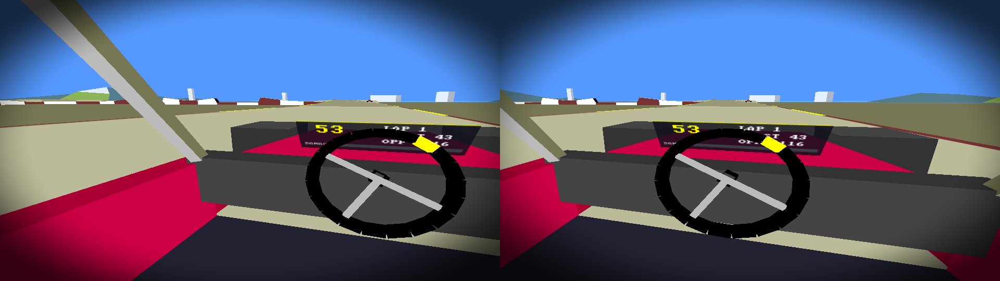
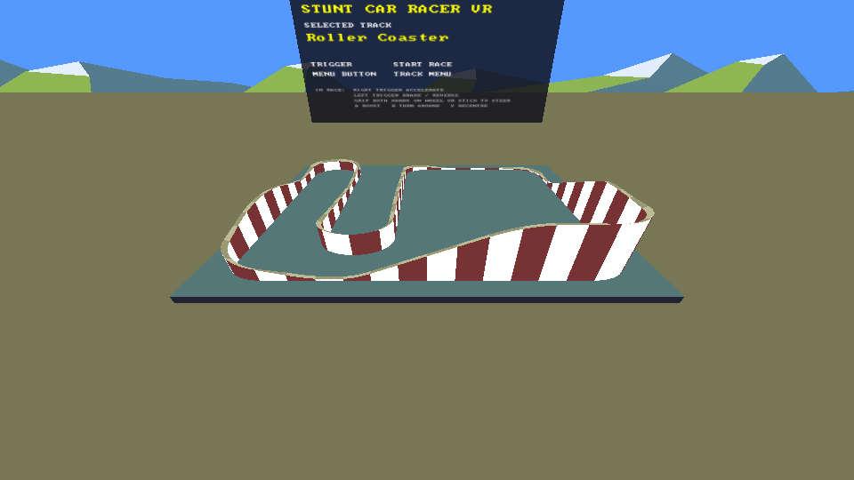
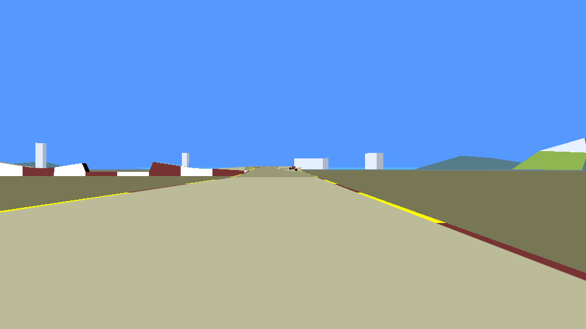
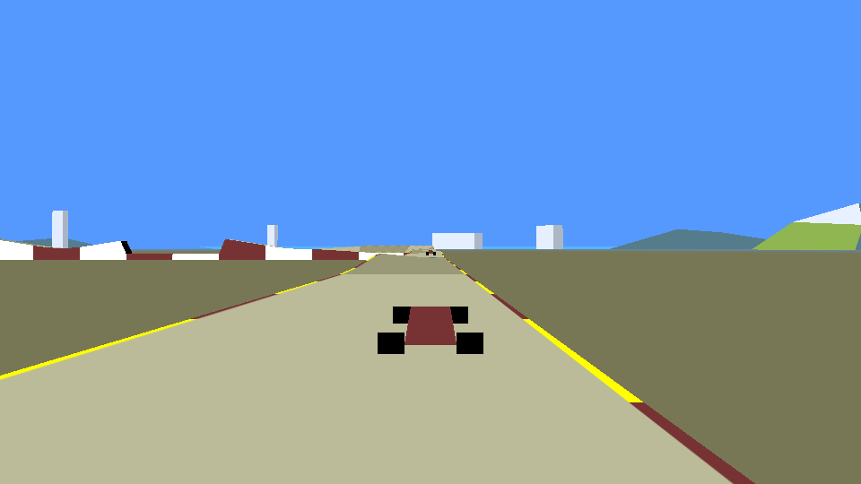

# Stunt Car Racer VR

A VR port of the classic Amiga game *Stunt Car Racer* (Geoff Crammond, 1989), built on the
open-source Windows remake ([stuntcarremake](http://sourceforge.net/projects/stuntcarremake),
via [abainbridge/stunt-car-racer-opengl](https://github.com/abainbridge/stunt-car-racer-opengl)).

One C++ codebase runs:

| Target | Graphics | VR | Status |
|---|---|---|---|
| **Windows PCVR** (SteamVR, Meta Link / Air Link, WMR, Pimax…) | OpenGL 3.3 | OpenXR `XR_KHR_opengl_enable` | compiles (checked with stub headers), not yet run on hardware |
| **Meta Quest standalone** (Quest 2 / Pro / 3 / 3S) | OpenGL ES 3 | OpenXR `XR_KHR_opengl_es_enable` | Gradle project ready, not yet built with the NDK |
| **Linux** (Monado) | OpenGL via EGL | OpenXR + `XR_MNDX_egl_enable` | builds and runs (flat mode verified) |
| **Any desktop, no headset** | OpenGL | – | runs as a normal windowed game |

The original Amiga physics, tracks, opponents and sounds are kept intact.

## Screenshots

These are offscreen renders from the test suite (Mesa software rendering), using the same code that draws
each eye in the headset.

| VR cockpit (left / right eye, comfort vignette on) | VR menu: tabletop diorama |
|---|---|
|  |  |
| **Classic view (flat screen)** | **Outside view** |
|  |  |

## What's new compared to the Windows remake

- **No more Direct3D 9 / DXUT / DirectSound / XInput.** The game core was ported to portable
  C++ with small compatibility shims, so the original physics code is essentially unchanged.
  - The code assumed 32-bit `long` (Windows). It now uses `int32_t`, so the fixed-point
    physics is identical on 64-bit ARM (Quest).
  - It needs signed `char`, which the build forces (ARM defaults to unsigned).
- **Fixed-rate physics.** The remake ran its physics every 4th display frame, so game speed depended on
  your monitor (the "too fast" problem). Physics now runs at a fixed **8.33 Hz** (the Amiga pace,
  `MIN.FRAMES = 6`). The remake's 12.5 Hz is one key away (F9).
  - Rendering interpolates car poses, so it's smooth at 72/90/120 Hz.
  - Verified: the race is bit-identical at 60, 72, 90, 120 and 144 Hz.
- **Analog steering.** The original steering is digital (left / none / right). For wheels, sticks and VR controllers the
  original logic is run "steering" and "not steering" and blended. Full lock is exactly the original behaviour, and a
  centred wheel is exactly "no steering" (verified by tests).
- **Real 3D everything.**
  - The 2D backdrop (horizon mountains, buildings, snow caps) is rebuilt as 3D geometry using the original scenery data.
  - A 3D cockpit has a roll cage, bonnet, wheels, a steering wheel that turns with your input, and a dashboard HUD.
  - The whole road is textured (the remake only textured the 11 segments nearest you).
- **VR menu as a tabletop diorama.** The track sits as a model on a table in front of you, with
  the menu panel above it. The world doesn't fly around you while you choose (comfort).
- **Comfort options:**
  - a vignette that darkens your peripheral view while airborne or tumbling
  - an optional horizon lock (the car still tilts around you)
  - recentre
  - automatic pause when you take the headset off
- **Force feedback wheels** (Logitech, Thrustmaster, Fanatec, Moza, …) via SDL3. The original physics has
  no tyre model, so forces are synthesised from what it does know:
  - speed-dependent centring, and a wheel that goes light in the air
  - jolts on landings, a shove on car-to-car hits
  - aligning torque in corners
  - vibration off-road and when scraping on a wrecked chassis

  The same effects drive gamepad rumble and VR controller haptics.

## Controls

| | Keyboard | Gamepad | VR controllers | Wheel |
|---|---|---|---|---|
| Steer | S / D or ← → | left stick | **grip both hands and turn** the virtual wheel (or one hand), or left stick | wheel |
| Accelerate | ↑ (Shift+↑ = boost) or Enter (accel + boost, original) | right trigger | right trigger | throttle pedal |
| Brake / reverse | ↓ or ' (original #) | left trigger | left trigger | brake pedal |
| Boost | Space (with ↑) | A / RB | A | any wheel button |
| Turn around | R | B | B | |
| Third-person chase camera | V | Y | X | |
| Pause | P (O to resume) | Start | Menu (B while paused = track menu) | |
| Recentre seat | Home | L3 | Y | |
| Track menu | M | Back | Menu (in menus) | |
| Menu: choose / select | 1-8, ↑ ↓ / S, Enter | D-pad / A | thumbstick / trigger | |
| Other | C = cockpit view (flat), F4 = scenery type, F9 = Amiga / remake pace, F2 = horizon lock, Esc = quit | | | |

**Wheel setup:** the first time a wheel is connected the menu asks you to press a wheel button
for each action (boost, view, turn around, pause, menu, select, recentre); redo it with F3, or X
on a VR controller in the menu. Pedals are learned automatically: press the **throttle** pedal,
then the **brake** pedal. The shifter D-pad navigates menus. If jolts push the wheel the wrong
way, set `ffb_invert = 1`.

## Settings

`settings.ini` is created on first run:
- Windows: `%APPDATA%\StuntCarVR\StuntCarVR\`
- Linux: `~/.local/share/StuntCarVR/StuntCarVR/`
- Quest: app storage

Settings include:
- mode (`auto` / `vr` / `flat`)
- physics rate and world scale
- comfort options
- force-feedback strengths, wheel axes and steering lock
- VR wheel lock
- a desktop spectator mirror

A `log.txt` is written next to it on Windows and Quest.

## Building

### Windows (PCVR or flat)

Requirements: Visual Studio 2022 (Desktop C++), CMake 3.22+, Git. SDL3 and the OpenXR loader are
downloaded automatically.

```
cmake -S . -B build -G "Visual Studio 17 2022" -A x64
cmake --build build --config Release
build\Release\StuntCarVR.exe          (or --flat / --vr)
```

Start SteamVR or the Meta Quest Link app first (whichever OpenXR runtime is active). Without a
headset, the game runs in a window.

### Meta Quest (standalone)

Requirements: Android Studio (or command-line SDK) with **NDK 27** and **CMake 3.22**, and a Quest
in developer mode.

```
android/fetch_deps.sh            (or android\fetch_deps.ps1 on Windows)
```

Then open `android/` in Android Studio and run on the headset, or from the command line:

```
cd android && gradle wrapper && ./gradlew installDebug
```

The app appears under *Unknown Sources* in the Quest library.

### Linux

```
sudo apt install libegl-dev libx11-dev          # plus SDL3's usual dependencies
cmake -S . -B build -G Ninja && ninja -C build
./build/StuntCarVR --flat
```

For VR on Linux you need Monado with `XR_MNDX_egl_enable`.

### Tests

```
ctest --test-dir build        # physics + force feedback (no window or GPU needed)
build/render_test gles out/   # Linux: offscreen renders of every view via headless EGL
```

- `sim_test`: all 8 tracks load and drive, physics is identical at 60–144 Hz, analog steering
  matches digital at full lock and centre, and the mixer produces audio.
- `ffb_test`: centring firms with speed, the wheel goes light in the air, and landings jolt and rumble.
- `render_test`: checks the face-culling rule (the original is left-handed Direct3D data) and renders
  every view (menu, preview, classic, cockpit, outside, VR stereo, VR diorama). The `gl` and `gles`
  modes give pixel-identical images.

## Code map

| Path | |
|---|---|
| `src/game/` | Original remake sources (physics `car_behaviour.cpp`, AI `opponent_behaviour.cpp`, tracks, car model, scenery) plus `game.cpp`, the new fixed-timestep game loop |
| `src/compat/` | Portable stand-ins for the Windows / D3DX / DirectSound types; software sound mixer |
| `src/render/` | GL / GLES renderer, cockpit and scenery meshes, text panels, vignette |
| `src/app/` | `main.cpp` (SDL3 app, flat and VR loops), scene setup, VR wheel controls, settings |
| `src/xr/` | OpenXR session, swapchains (4x MSAA), actions, haptics, recentring, Quest 90 Hz |
| `src/input/` | Force-feedback model and SDL3 keyboard / gamepad / wheel input |
| `android/` | Quest Gradle project |
| `reference/` | The original `StuntCarRacer.cpp` main file, for reference while porting |

**Coordinate spaces.** The game keeps the original left-handed Direct3D units: 4096 per track
cube, +z forward. The renderer maps them to right-handed OpenXR metres (1/64 m per unit, z
mirrored). With that scale the car is about 4 m long, and top speed is about 140 mph at the Amiga pace.

## Known gaps / next steps

- **Not yet tested on real headsets or wheels.** VR, Quest and force-feedback code compiles but
  needs a hardware shakedown:
  - culling and stereo look correct in offscreen renders
  - seat height, wheel position and FFB strengths will need tuning by feel
- **Quest performance:**
  - single-pass multiview (`GL_OVR_multiview2`) and fixed foveated rendering are not used yet
  - the scene is very light, so two passes should still hold 72–90 Hz
- **Physics latency:** 8.33 Hz physics means up to ~120 ms between input and response, as on the
  Amiga. A higher-rate physics mode would need the original constants rescaled (the remake started
  this with `HIGHER_FRAME_RATE`).
- The original HUD's damage crack and the speed bar are simplified into the dashboard panel.
- Super League, two-player link-up, the start-of-race chain/crane graphics and action replay are not ported.

## Licence and credits

- Remake code © Daniel Vernon and abainbridge, BSD 2-Clause (`LICENSE.original`). New code
  in this port is offered under the same terms.
- The track data, sound samples and physics algorithms come from the original Amiga *Stunt Car
  Racer*, © Geoff Crammond / MicroStyle / MicroProse and current rights holders (see the original
  remake's notes). Distributing builds publicly may need permission from them. A personal build is
  the safe option.
- 8x8 font: public domain IBM VGA font (Marcel Sondaar), as shipped with SDL3.
